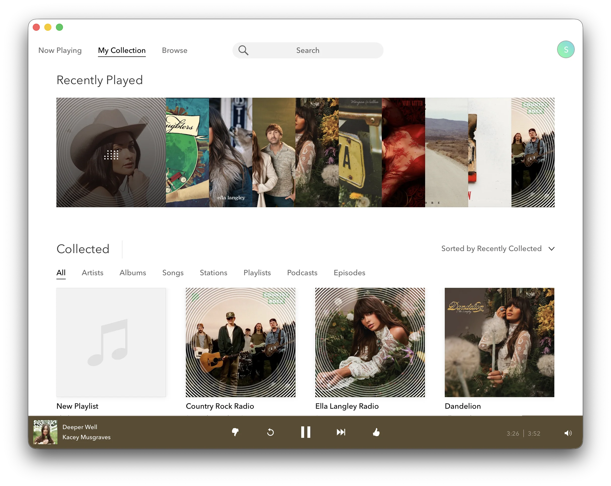

# Pandora Wrapper



An unofficial desktop wrapper around [pandora.com](https://www.pandora.com) built with [Tauri](https://tauri.app). Runs Pandora's web player as a native-feeling app on macOS, Windows, and Linux.

> **Disclaimer:** This is an independent, unaffiliated project. It is not endorsed by, sponsored by, or otherwise associated with Pandora Media, LLC. "Pandora" and the Pandora logo are trademarks of Pandora Media, LLC; this project uses them solely to indicate compatibility. Pandora's service is currently only available in the United States and select other countries — this wrapper does not change that geo-restriction.

## Features

- Native window chrome on macOS (transparent title bar, traffic lights overlaid on Pandora's nav).
- Custom CSS injected to clean up the chrome (hidden scrollbars, top bar layout adjustments, splash screen suppressed).
- Conditional in-app Back button on detail pages, with mouse and keyboard support. It stays hidden on top-level pages such as My Collection and Browse.
- Keyboard shortcuts for playback and feedback (see below).
- Drag the window from the top nav region (everywhere except interactive elements).
- The wrapper adds no telemetry or tracking. Pandora's website still runs inside the app.

## Keyboard shortcuts

| Key | Action |
| --- | --- |
| `F8` / Media Play/Pause | Play / pause the current track |
| `F9` / Media Next | Skip to the next track |
| `F7` / Media Previous | Restart the current track (Pandora's "Replay") |
| `↑` | Toggle thumbs up on the current track |
| `↓` | Toggle thumbs down on the current track; Pandora may skip it |
| `Enter` or `Space`, with Back focused | Go back without changing playback |

Function-key and arrow shortcuts work while the app is focused and are ignored while typing, with modifier keys held, or on key repeat. Depending on your keyboard settings, use Fn with F7–F9 to send ordinary function keys. Hardware media keys are routed separately by the operating system.

Playback and feedback shortcuts target the bottom player, including while session history is open. They do nothing when the matching player control is unavailable. Widgets that use arrow keys, such as sliders and menus, retain their normal keyboard behavior.

Use Tab or Shift+Tab to reach Back. Its appearance stays the same when focused. Pandora also provides its own playback shortcuts, including Space for play/pause when focus is outside a control.

## Build from source

No pre-built binaries are distributed — build it yourself.

You'll need:

- [Rust](https://www.rust-lang.org/tools/install) (stable)
- [Node.js](https://nodejs.org/) (an active LTS release)
- Platform-specific build prerequisites — see [Tauri's prerequisites guide](https://v2.tauri.app/start/prerequisites/)

```sh
git clone https://github.com/scttymn/pandora-wrapper.git
cd pandora-wrapper
npm ci
npm run tauri build
```

For a locally signed macOS build, use `APPLE_SIGNING_IDENTITY=- npm run tauri build`. This applies an ad-hoc signature; it does not notarize the app for distribution.

Output lands in `src-tauri/target/release/bundle/` — `.app`/`.dmg` on macOS, Windows installers, and `.deb`/`.AppImage` on Linux.

### Installing or replacing a macOS build

1. Quit Pandora completely with Command+Q.
2. Open the `.dmg` in `src-tauri/target/release/bundle/dmg/`.
3. Drag Pandora into Applications and choose Replace if prompted.
4. Eject the disk image and launch Pandora from Applications.

The disk image filename includes the version number. Updates are installed manually; the wrapper has no automatic updater.

## Development

Start the development app:

```sh
npm run tauri dev
```

### Customizing the wrapper

- [`src-tauri/src/wrapper.js`](src-tauri/src/wrapper.js): navigation, keyboard shortcuts, media actions, and window dragging.
- [`src-tauri/src/wrapper.css`](src-tauri/src/wrapper.css): visual tweaks; title-bar spacing is applied only on macOS.
- [`src-tauri/src/lib.rs`](src-tauri/src/lib.rs): native window setup and injection of the CSS and JavaScript.

Both injected files are embedded with `include_str!`. Changes require a Rust rebuild and app restart, which the development watcher handles; they are not browser-only hot reloads. Rebuild the installer to update the copy in Applications.

### Checks

```sh
npm test
cargo fmt --manifest-path src-tauri/Cargo.toml -- --check
```

The regression tests cover shortcut targeting, unavailable controls, typing and modifier exclusions, repeat events, media-action registration, route changes, and Back-button keyboard activation.

Live checks on macOS covered F7/F8/F9, arrow feedback, typing and modifier exclusions, holding Up, and Back activation with Enter and Space. Physical hardware media-key events and Windows/Linux behavior still need manual verification.

When testing against a real Pandora account, note the existing rating before using arrow shortcuts and restore it afterward. If thumbs-down skips a song, remove the test dislike from that song in session history. Preserve any rating that was present before the test.

## License

[MIT](LICENSE).
